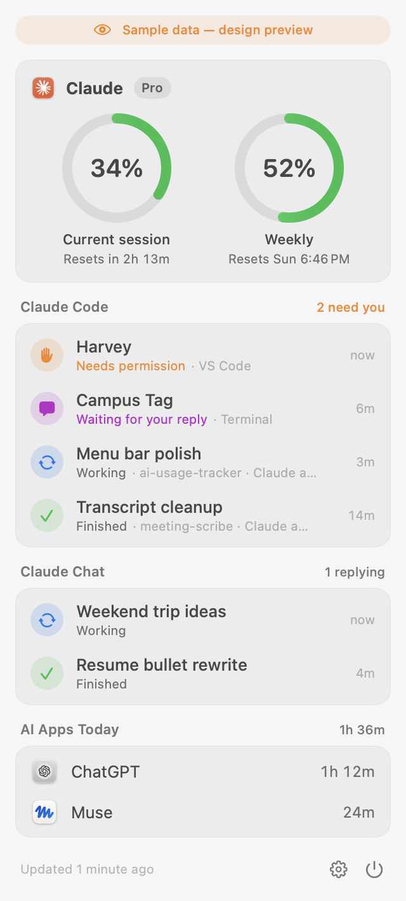
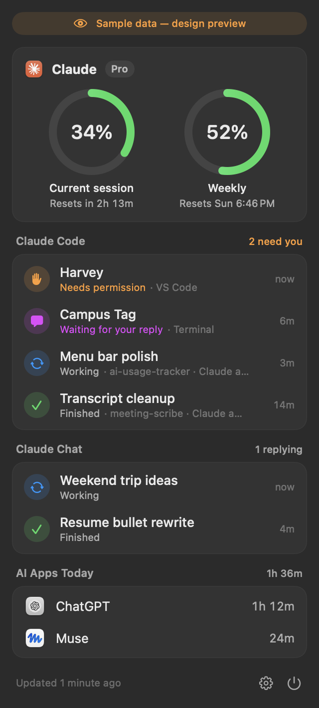
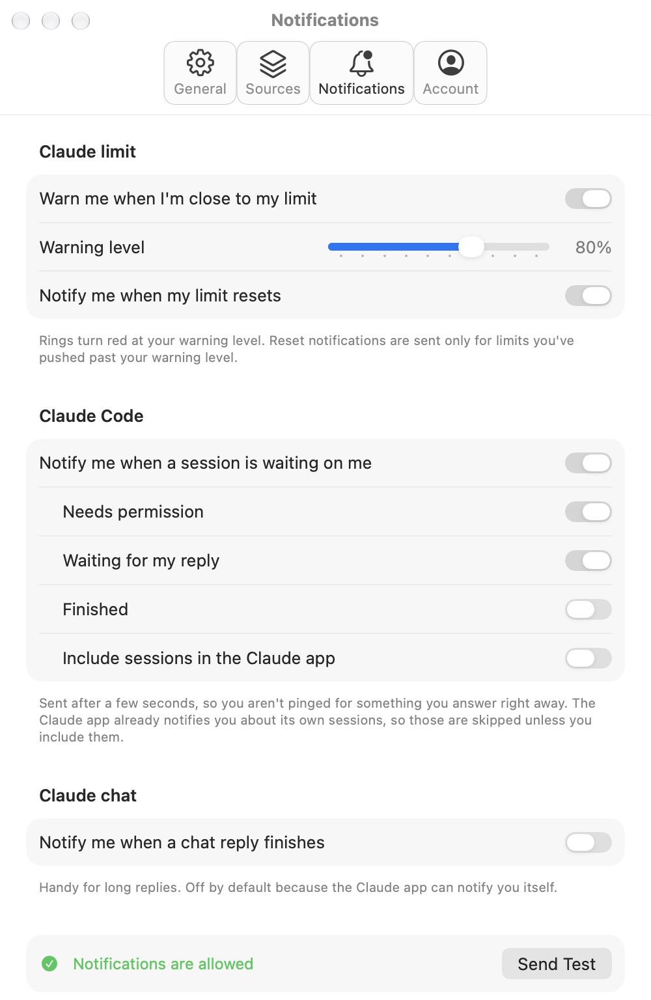

# AI Usage Tracker

A native macOS menu bar app that shows how much of my Claude plan limit I've used, built with SwiftUI.

**Status:** version 1.0. Claude limit reading, the dropdown, live Claude Code and chat status, notifications, and time tracking for other AI apps, each verified on a real Mac.

<p align="center">
  
  
</p>

<p align="center">
  
</p>

<p align="center"><sub>Screenshots use clearly labeled sample data. They're generated by the app itself: <code>./scripts/snapshot-design.sh</code>.</sub></p>

## What it does

- **Menu bar ring** that fills up with your current 5-hour Claude usage and shifts from green to orange to red.
- **Dropdown** with rings for the current session and the weekly limit, plus reset times.
- **Claude Code sessions**: each open session's status (working, needs permission, waiting for your reply, finished), reported by Claude Code hooks. Works in the terminal, the VS Code extension, and the Claude desktop app's Code tab. Sessions in the Claude app are named by their title there ("Fix login bug"), with the project folder underneath; elsewhere they're named by project folder.
- **Claude Chat**: regular chats (in the Claude app, on the web, or on your phone) show "Working" while Claude writes a reply and "Finished" for 10 minutes after. Tap one to open it in the Claude app.
- **AI Apps Today**: time spent in other AI apps (ChatGPT, Muse, or any app you add), counted only while the app is in front and you're actually at the Mac (pauses when idle 2+ minutes, locked, or asleep). No special permissions needed.
- **Notifications** when you reach your warning level (80% by default), when a limit you pushed past it resets, and when a Claude Code session needs you.
- **Settings window** with standard Mac tabs: General, Sources, Notifications, Account.
- Full light and dark mode support, using system fonts and materials.

## How the limit reading works

Anthropic doesn't offer an official API for plan usage, so the app reads the same data claude.ai's own Usage page uses:

1. You sign in once in a small window showing claude.ai's real sign-in page.
2. The resulting session key is stored in the macOS Keychain. Nothing else about your login is saved to disk.
3. Every few minutes, a hidden copy of Safari's web engine asks claude.ai for your usage, so requests look like ordinary browser traffic.

Because this relies on an undocumented endpoint, it can break if claude.ai changes. The app shows your last reading with a warning if an update fails.

## How Claude Code status works

Claude Code can run a command on events like "a prompt was sent" or "Claude stopped" ([hooks](https://code.claude.com/docs/en/hooks)). The app ships a tiny helper, `ai-usage-hook`, that records each session's latest status in `~/Library/Application Support/AIUsageTracker/sessions/`. The helper prints nothing (hook output can reach Claude's conversation) and always exits immediately.

Regular Claude chats have no hooks, and the Claude app doesn't record when a reply starts or finishes. Instead, the app asks claude.ai (unofficially, through the same sign-in as the limit). claude.ai saves Claude's reply only once it's finished, so while Claude is writing, the newest message in the chat is still yours. That's the signal. (claude.ai also has a `completion_status` request that looked promising, but in a live test it said "not pending" in the middle of a reply.) Verified live: your message became the newest one the moment you sent it, and Claude's reply appeared when it finished. The app looks at your 5 most recent chats, downloads a chat only when it changes, and checks every 8 to 45 seconds depending on activity (every 3 minutes when you're away). Like the limit reading, this is undocumented and could change. (Cowork tracking was built and later removed: Anthropic merged Cowork into chat in September 2026.)

Settings → Sources → **Connect** adds the hooks to `~/.claude/settings.json` (backing the file up first); **Disconnect** removes only the app's own entries.

## Building

No Xcode required, only Apple's free Command Line Tools.

```bash
./scripts/run.sh                 # build, install to ~/Applications, and launch
./scripts/snapshot-design.sh     # save light/dark screenshots with sample data to build/design-shots
./scripts/make-icon.sh           # redraw the app icon (design lives in scripts/make-icon.swift)
./scripts/test.sh                # run the checks (app-time counting rules)
```

Notes:

- The build uses the macOS 26 SDK. The macOS 27 SDK's SwiftUI needs a compiler plugin that only ships with Xcode.
- If a code-signing certificate named `AI Usage Tracker Dev` exists in your login keychain, builds are signed with it; otherwise they're signed ad hoc.
- Diagnostic log: `~/Library/Logs/AIUsageTracker/app.log` (never contains secrets).

## Project layout

```
Sources/AIUsageTracker/
  App/          App entry point and design-preview mode
  ClaudeLimit/  claude.ai sign-in, usage reading, and refresh schedule
  ClaudeCode/   Live session list from the hook helper, hook install/remove
  Notifications/ Usage warnings, reset pings, and session nudges
  AppTime/      Time in other AI apps (counting rules in AppTimeLedger)
  Dashboard/    Menu bar icon and dropdown
  Design/       Shared colors, spacing, and the ring gauge
  Settings/     Settings window and saved preferences
  Support/      Keychain, logging, login item, helpers
Sources/Hook/   ai-usage-hook, the helper Claude Code runs for each hook event
Tests/          Checks run by scripts/test.sh
```
